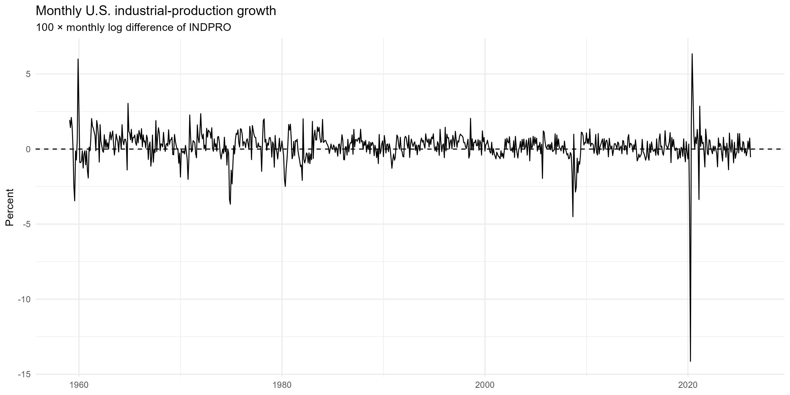
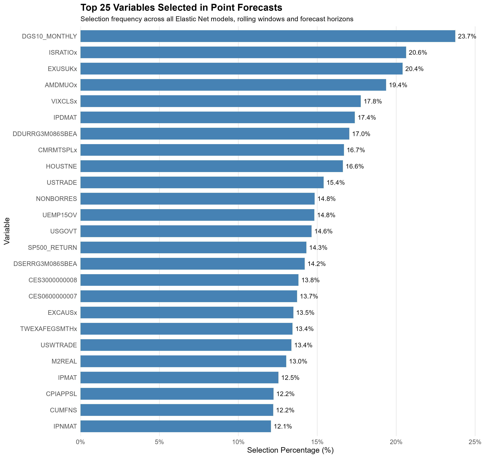

# Forecasting U.S. Industrial Production Growth

**Elastic Net forecasting with FRED-MD, daily S&P 500 returns, 10-year U.S. Treasury yields, and financial interaction terms.**

This repository contains the R analysis, seminar report, figures and published result tables for a 2026 econometrics project. It examines whether financial-market information improves out-of-sample forecasts of monthly U.S. industrial production growth beyond autoregressive and FRED-MD-based models.

## Research question

Do S&P 500 returns and 10-year Treasury yields, when used jointly through interaction terms, improve out-of-sample forecasts of U.S. industrial-production growth?

- **Target:** 100 × monthly change in log industrial production (`INDPRO`).
- **Horizon:** 1, 3, 6, 12 and 24 months.
- **Estimation windows:** 120, 180 and 240 months (main comparison: 180 months).
- **Point models:** AR(1) benchmark and Elastic Net models with expanding macroeconomic/financial information sets.
- **Quantiles:** 0.05, 0.10, 0.25, 0.50, 0.75, 0.90, 0.95 (180-month window).
- **Evaluation:** MSFE, Theil's U, Diebold–Mariano tests, quantile Pinball Loss and additional tests.

## Main findings from the submitted report

In the 180-month window, AR(1) has the lowest MSFE at 1, 3, 12 and 24 months. Elastic Net improves MSFE numerically at the 6-month horizon (2.135 vs. 2.243 for AR(1)), but the improvement is not statistically significant by the reported DM tests. The interaction term does not consistently improve point forecasting. In quantile forecasting, selected lower-tail gains occur — e.g., Q-EN-3 at the 6-month 5% quantile — but the reported DM tests do not establish significant superiority.

## Repository structure

```text
forecasting-us-industrial-production/
├── README.md
├── run_all.R
├── report/
│   ├── MP_FRED_report.pdf
│   └── MP_FRED_presentation.pdf
├── code/
│   ├── 01_download_data.R
│   ├── 02_preprocessing.R
│   ├── 03_feature_engineering.R
│   ├── 04_elastic_net.R
│   ├── 05_quantile_elastic_net.R
│   ├── 06_evaluation.R
│   └── original_analysis_reference.R
├── figures/
│   ├── industrial_production_growth.png
│   ├── variable_selection_frequency.png
│   └── forecast_results.png
├── results/
│   ├── msfe_results.csv
│   ├── dm_results.csv
│   └── quantile_results.csv
└── packages.txt
```

## Setup and running the analysis

1. Install R and the packages in [`packages.txt`](packages.txt). `01_download_data.R` installs missing packages automatically.
2. Download the appropriate **FRED-MD 2026-07 vintage** from the [Federal Reserve FRED-MD database](https://research.stlouisfed.org/econ/mccracken/fred-databases/) and save as `data/raw/2026-07-MD.csv`. This input file was not included in the uploaded source materials. Alternatively set the environment variable `FRED_MD_FILE` to its absolute path.
3. Create a free [FRED API key](https://fred.stlouisfed.org/docs/api/api_key.html) and set it **in your local environment** as `FRED_API_KEY`. Do not publish the key on GitHub. For example, in an R session use `Sys.setenv(FRED_API_KEY = "YOUR_KEY")`.
4. From the repository root run `Rscript run_all.R` (or `source("run_all.R")` within an R session). Internet access is required to download S&P 500 and Treasury series.

The script defaults to `FORECAST_END_DATE=2026-06-30` to reflect the reported study period; change this environment variable to update the sample. Detailed analysis outputs go to `results/details/`, and freshly recalculated summary CSVs to `results/generated/`. The original multi-stage script is preserved in `code/original_analysis_reference.R` with sensitive local settings redacted.

**Important:** The six R scripts represent consecutive stages of one R session and should be executed through `run_all.R`, not individually in fresh sessions. The full rolling analysis may require substantial compute time.

## Figures






## Results provenance

The committed results CSVs transcribe **rounded values from the submitted report** (Tables 2, 3 and 5). They are provided for browsing and are **not claimed to be newly reproduced runs**. The quantile table lists only the winning model for each horizon/quantile combination; a full model-by-model table requires executing the R code. Plots are extracted from the report or derived from its published tables. Re-run with the intended vintage for reproducible output; data revisions and changes in external downloads can affect results.

## Data sources

- [FRED-MD macroeconomic database](https://research.stlouisfed.org/econ/mccracken/fred-databases/)
- [FRED 10-year Treasury yield (DGS10)](https://fred.stlouisfed.org/series/DGS10)
- [Yahoo Finance S&P 500 (^GSPC)](https://finance.yahoo.com/quote/%5EGSPC/)

## Project documents

- [Seminar report](report/MP_FRED_report.pdf)
- [Project presentation](report/MP_FRED_presentation.pdf)

**Author:** Madhavi Panchangum · M.Sc. Econometrics · Summer Semester 2026.
